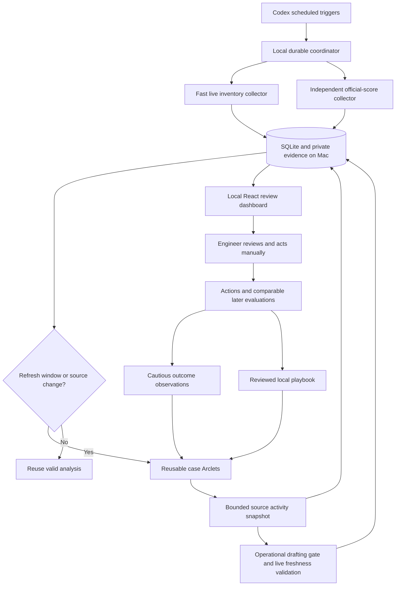

# Architecture

Python/FastAPI owns a SQLite WAL database, coordinator locks, worker registry,
evidence export, and local review endpoints. React/Vite provides the case queue,
case detail, explanations, history, drafts, action/coverage log, operations and
learning desk. Local source data is escaped as text, never interpreted as HTML.

The collector uses existing dbexec stdio MCP servers inside its Arclet. The small
transport has an explicit tool allowlist. SQL cells are ingested without preview
truncation by reading the MCP's own full-result spill files before server exit.
Source schemas are described before querying. Salesforce fields are discovered
and checked against the allowed contract; restricted fields are excluded.

Live Salesforce inventory uses the engineer's email and IsClosed, with keyset
pagination in bounded pages. It includes every class and special open status.
Closed cases use actual closure timestamps. A different-owner response fails
validation. Snapshot rows never overrule live lifecycle or ownership.

Evaluations retain result ID, phase, source, model/rubric, evidence cutoff,
production time, explanations and missing values. Current open and closed serving
sources take precedence over revision-ledger projections. Ledger fallback is
labelled when a serving query fails. Results are immutable per revision; an
unexpected score change under the same revision fails atomically.

Default case jobs collect recent comments and explicitly linked Jira/Slack activity
under a 180-second budget. Source ownership, lifecycle and revision are verified.
The early context is exported before model drafting, so source activity, observed
sent actions and attributed writing preferences can appear independently. Privacy
summaries remain documents, never confirmed verbatim writing examples. Ambiguous
attribution and Slack IDs alone do not teach writing style.

Noninteractive Isaac has a 300-second drafting budget and a strict operational
tool gate: own result files and structured output only. It cannot run skills,
agents, enrichment, SQL or diagnostic tools. Each audience/purpose needs three
distinct lengths (plus follow-up conditions) or an explicit no-message decision.
The coordinator publishes partial valid results, allows one coverage repair and
bounds attempts per window and revision. Analytics checkpoints import scores
without modifying newer live inventory. Neither score availability nor diagnostics
is a prerequisite for message drafting.

Explicit optional investigation runs interactive Isaac in its owned Arclet terminal. The
coordinator checks that exact pane is idle, starts the guarded runner, waits for
the SessionStart hook and terminal prompt, then types `/support-agent:start` as
a user command using ArcaTerm's addressed, journalled pane API. This respects the
command's `disable-model-invocation` setting and never sends text to an arbitrary
focused pane. A dispatch receipt proves submission; session metadata separately
verifies intake. Documented intake/read subagents inherit the same tool gate.
Prompts contain a fixed case/run/revision manifest and the current evidence.
The separate tool gate enforces draft-only actions, even if a nested skill offers
Slack, email, feedback, write-back, or deployment actions. Normal intake telemetry
and enrichment are authorized; message/feedback submission is excluded.

Workers export a report using the supplied JSON schema. A bounded runner
stops only that job's agent and descendants after export or timeout. The runner independently checks live owner,
update timestamp and open lifecycle before exposing the result. The coordinator
checks the job manifest and local source revision, saves evidence/audits, then
publishes analysis and drafts. No transcript endpoint is required. Agent claims
about tool usage and official ingested telemetry remain distinct.

The local service restarts at login. Codex heartbeats and the resume checker share
the same process lock and schedule-window checkpoint. Failures remain visible;
successful partial results survive, and one failed case does not hide other cases.
