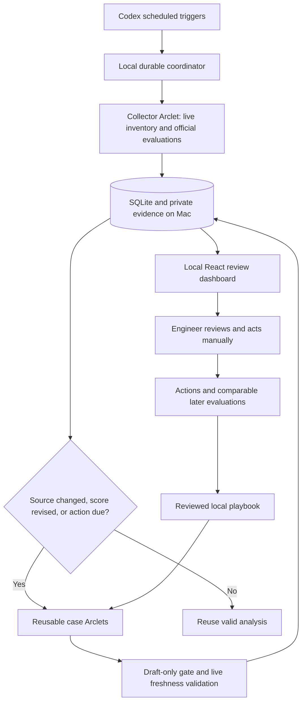

# Architecture

Python/FastAPI owns a SQLite WAL database, coordinator locks, worker registry,
evidence export, and local review endpoints. React/Vite provides the case queue,
case detail, explanations, history, drafts, action/coverage log, operations and
learning desk. Local source data is escaped as text, never interpreted as HTML.

The collector uses existing dbexec stdio MCP servers inside its Arclet. The small
transport has an explicit tool allowlist. SQL cells are ingested without preview
truncation by reading the MCP's own full-result spill files before server exit.
Source schemas are described before querying. Salesforce fields are discovered
and checked against the allowed contract; restricted fields are excluded.

Live Salesforce inventory uses the engineer's email and IsClosed, with keyset
pagination in bounded pages. It includes every class and special open status.
Closed cases use actual closure timestamps. A different-owner response fails
validation. Snapshot rows never overrule live lifecycle or ownership.

Evaluations retain result ID, phase, source, model/rubric, evidence cutoff,
production time, explanations and missing values. Current open and closed serving
sources take precedence over revision-ledger projections. Ledger fallback is
labelled when a serving query fails. Results are immutable per revision; an
unexpected score change under the same revision fails atomically.

Each case worker runs the installed Isaac/Support Agent skills in an owned Arclet.
Prompts contain a fixed case/run/revision manifest and the current evidence.
The separate tool gate enforces draft-only actions, even if a nested skill offers
Slack, email, feedback, write-back, or deployment actions. Normal intake telemetry
and enrichment are authorized; message/feedback submission is excluded.

Workers return a JSON-schema result. The runner independently checks live owner,
update timestamp and open lifecycle before exposing the result. The coordinator
checks the job manifest and local source revision, saves evidence/audits, then
publishes analysis and drafts. No transcript endpoint is required. Agent claims
about tool usage and official ingested telemetry remain distinct.

The local service restarts at login. Codex heartbeats and the resume checker share
the same process lock and schedule-window checkpoint. Failures remain visible;
successful partial results survive, and one failed case does not hide other cases.
